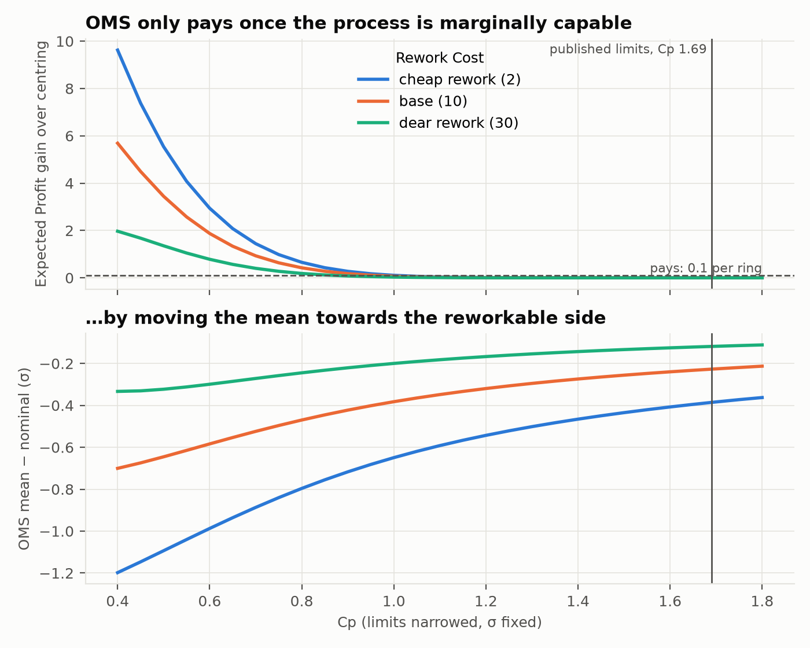
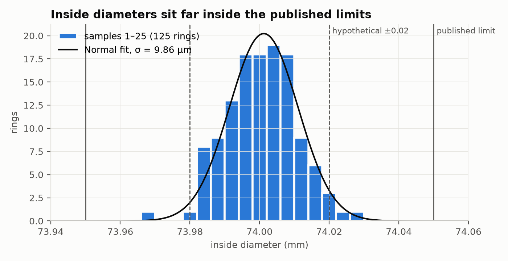
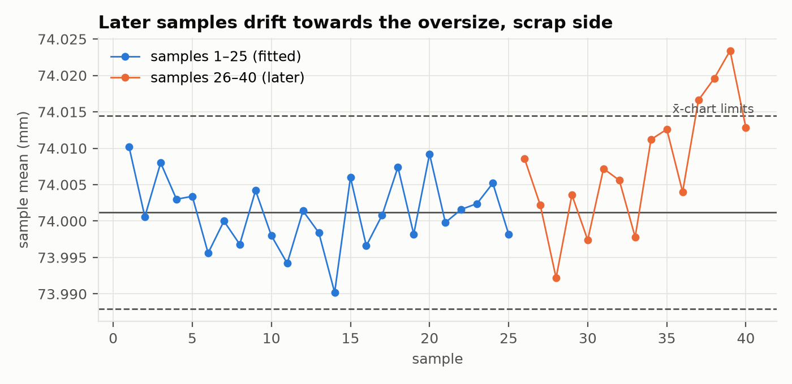
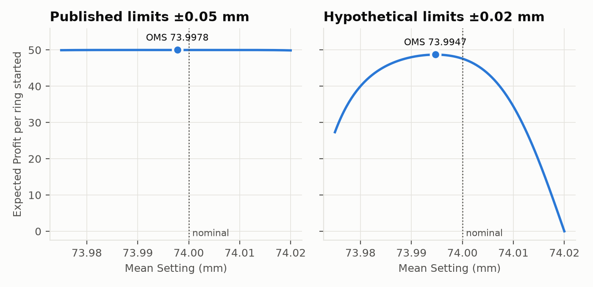

# Piston-ring inside diameter: an OMS case study

_Generated by `run_case_study.py`; every number is in `results.json`. Costs, the Rework Side and the rework model are hypothetical (see [PROVENANCE](../data/PROVENANCE.md))._

## Headline

At the published limits (74 ± 0.05 mm) the process has Cp 1.69. OMS recommends 73.9978 mm, and gains 9.55e-06 per ring started over centring at 74.000: nothing worth acting on. Narrowing the limits with σ fixed, the gain reaches 0.1 per ring (0.1 % of the Selling Price) at Cp ≈ 0.96 under the base costs. At hypothetical limits of ±0.02 mm (Cp 0.68) OMS moves the mean -0.0053 mm (-0.54 σ), towards the reworkable undersize side, and gains 1.11 per ring over centring.

## Data

200 inside diameters (mm, to 0.001) of forged piston rings in 40 samples of 5. Samples 1–25 are the in-control preliminary samples and are the fit; samples 26–40 are later production and are used as a drift scenario. Samples 1–25: mean 74.0012 mm, pooled within-sample σ 9.86 µm (R̄/d₂ gives 9.79 µm), Shapiro–Wilk p = 0.79. No ring is outside 73.95–74.05.

## Model

One Stage with one Feature, the bore, Normal with the fitted σ. An undersize bore is re-machined (Rework Side LOWER) and an oversize one is scrapped; a re-machined ring is a fresh draw at the Mean Setting. Hypothetical economics per ring: Selling Price 100, Material Value 20, Processing 30, Rework 10 per pass, Scrap 0 extra (a scrapped ring loses its material and processing, ADR 0006). The optimiser is the engine default, as in the web app.

## Results

### Published limits 73.95–74.05 mm (Cp 1.69, current Cpk 1.65)

| Mean Setting | mm | E(PR) per ring started | Final Conformance | Scrap probability | Expected reworks | Cost per conforming ring |
|---|---|---|---|---|---|---|
| Nominal 74.000 | 74.0000 | 50.0000 | 1.000000 | 1.98e-07 | 1.98e-07 | 50.0000 |
| Current process | 74.0012 | 50.0000 | 1.000000 | 3.72e-07 | 1.04e-07 | 50.0000 |
| OMS optimum | 73.9978 | 50.0000 | 1.000000 | 5.85e-08 | 6.36e-07 | 50.0000 |

### Hypothetical limits 73.98–74.02 mm (Cp 0.68, current Cpk 0.64)

| Mean Setting | mm | E(PR) per ring started | Final Conformance | Scrap probability | Expected reworks | Cost per conforming ring |
|---|---|---|---|---|---|---|
| Nominal 74.000 | 74.0000 | 47.6106 | 0.978278 | 2.17e-02 | 2.17e-02 | 51.3322 |
| Current process | 74.0012 | 46.9664 | 0.971267 | 2.87e-02 | 1.60e-02 | 51.6442 |
| OMS optimum | 73.9947 | 48.7184 | 0.994485 | 5.52e-03 | 7.30e-02 | 51.0114 |

## Sensitivity

- **Rework Cost.** Cp at which OMS gains 0.1 % of the Selling Price over centring: cheap rework (2): 1.01, base (10): 0.96, dear rework (30): 0.87.
- **σ uncertainty** (400 bootstrap resamples of whole samples): σ 8.39–11.25 µm, so Cp at the published limits 1.48–1.99. At ±0.02 mm the OMS shift is -0.0066 to -0.0040 mm and its gain 0.44–1.96 (95 % intervals).
- **Tails.** A t fit to the within-sample residuals goes to ν → ∞ (ν > 1000): the data show no heavier tails than a Normal. At ±0.02 mm the t model's optimum is 73.9947 mm (Normal 73.9947).
- **Separate rework target** (`per_state`). At ±0.02 mm: first pass 73.9947, re-machining 73.9947 mm, Expected Profit 48.7184 (one target: 48.7184). With rework as a fresh draw, a re-machined ring faces the same trade-off as a new one, so a separate target can add little.

## Drift

Samples 26–40 average 74.0077 mm, the highest sample 74.0234. At the published limits Expected Profit there is 49.9991 and 49.6510, against 50.0000 at the optimum: only the worst sample costs anything. At ±0.02 mm it would be 39.4233 and -13.4892, against 48.7184 at the optimum. With tight limits, holding the mean where it is set is worth far more than the 1.11 that OMS gains by choosing it.

## Validation

- Engine against the closed form f_C = p_C / (1 − p_R) etc., over 4 limit widths × 21 means: largest difference in Expected Profit 2.8e-14.
- Ring-by-ring simulation of 2,000,000 rings at the ±0.02 optimum: 48.7188 ± 0.0056 against the engine's 48.7184 (z = +0.07).

## Limitations

- The costs, the Rework Side and rework itself are hypothetical: the rings are forged, and nothing in the source says an undersize bore is re-machined.
- A re-machined ring is modelled as a fresh draw at the Mean Setting; a real pass depends on the previous size.
- OMS moves only the mean, keeping σ. That a forging process can be re-targeted by a few µm is assumed.
- The published limits come from Montgomery's capability example and still need checking against the book.
- All money is per ring started; there is no production volume, so no annual figure.

## Reproduce

From `case_studies/`: `uv run python piston_rings/run_case_study.py`. The web app presets `cs-piston-rings` and `cs-piston-rings-tight` load this model at the current mean; press Optimise.
